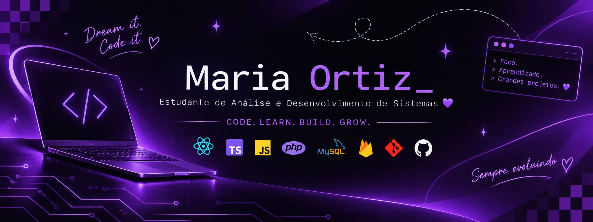

# Olá! Eu sou Maria Ortiz 💜

### Estudante de Análise e Desenvolvimento de Sistemas

Desenvolvedora em formação | Mobile & Web Development

[GitHub](https://github.com/mariaortiz-dev)

---

## ✨ Sobre mim

Sou estudante de Análise e Desenvolvimento de Sistemas, apaixonada por tecnologia e desenvolvimento de software.

Estou sempre buscando aprender novas ferramentas, aprimorar minhas habilidades e transformar ideias em projetos.

- 🎓 ADS — conclusão prevista para junho de 2027.
- 💻 Interesse em desenvolvimento web e mobile.
- 🌱 Sempre aprendendo e evoluindo.
- 🚀 Em busca de oportunidades na área de tecnologia.

---

## 🛠️ Tecnologias e ferramentas

---

## 💜 Projetos em destaque

### 🌱 EcoMatch

Aplicativo mobile voltado à sustentabilidade e incentivo à reciclagem.

**React Native | TypeScript | Expo | Firebase**

[Conheça o projeto](https://github.com/mariaortiz-dev/EcoMatch)

### 🐾 Pet-Conecta

Sistema web voltado ao universo pet.

**PHP | MySQL | HTML | CSS**

[Conheça o projeto](https://github.com/mariaortiz-dev/Pet-Conecta)

### 💧 AquaMind

Projeto acadêmico de desenvolvimento web com banco de dados.

**PHP | MySQL**

[Conheça o projeto](https://github.com/mariaortiz-dev/AquaMind)

---

## 📚 Atualmente estudando

- Desenvolvimento de aplicações web e mobile.
- Programação orientada a objetos.
- Banco de dados.
- Arquitetura de aplicações.
- Boas práticas de desenvolvimento.

---

## 📫 Vamos nos conectar?

Estou aberta a oportunidades de estágio e novos desafios na área de tecnologia!

- 💼 LinkedIn: linkedin.com/in/maria-ortiz-ba1b46437
- 📧 E-mail: mariaortiz.codes@gmail.com

### Code. Learn. Build. Grow. 💜

